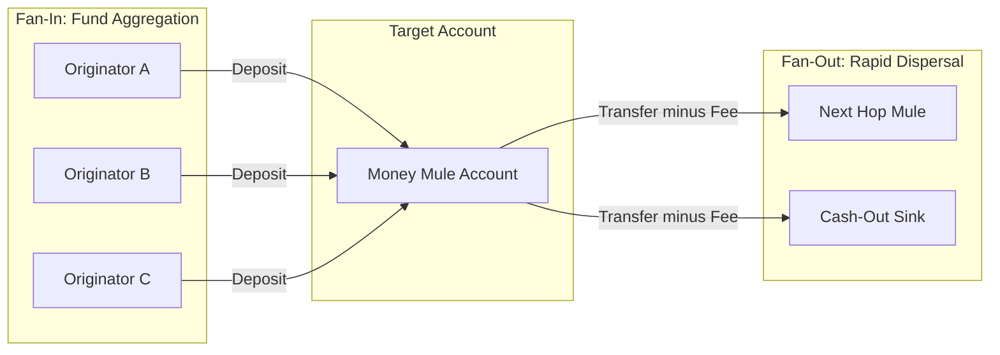
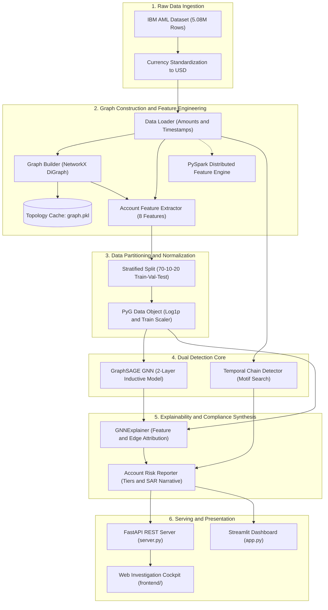
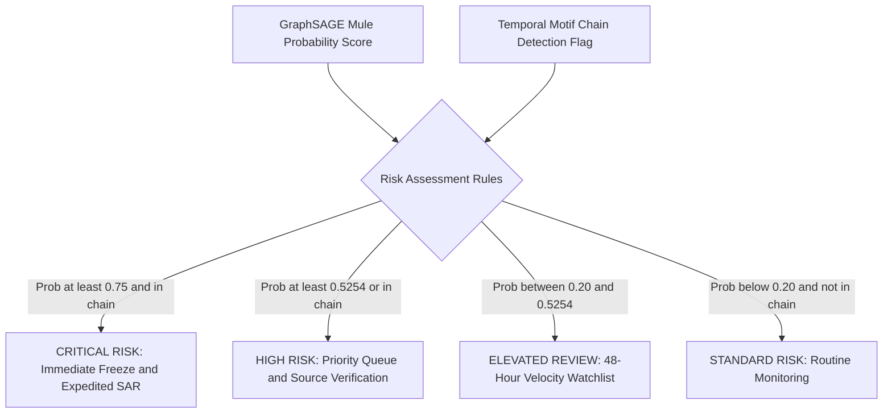
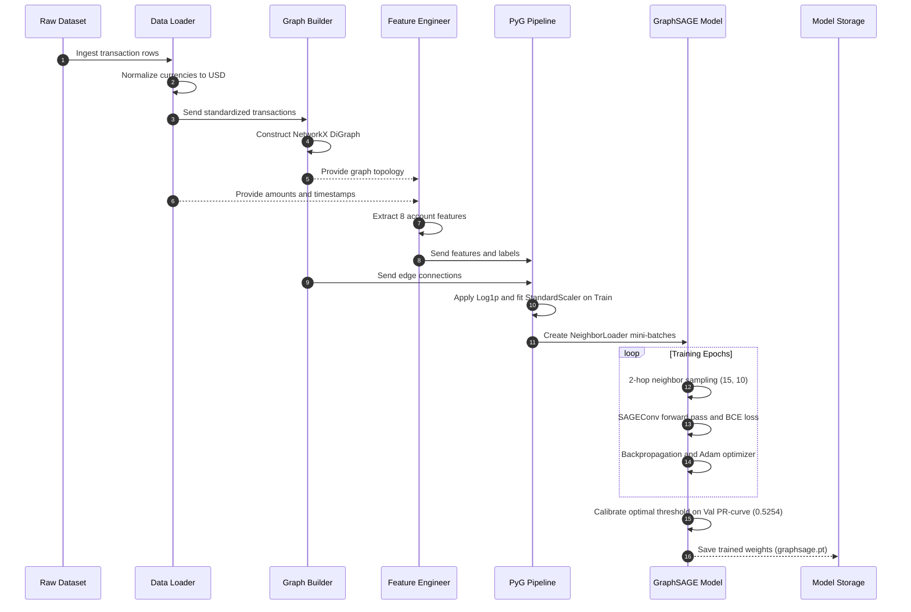
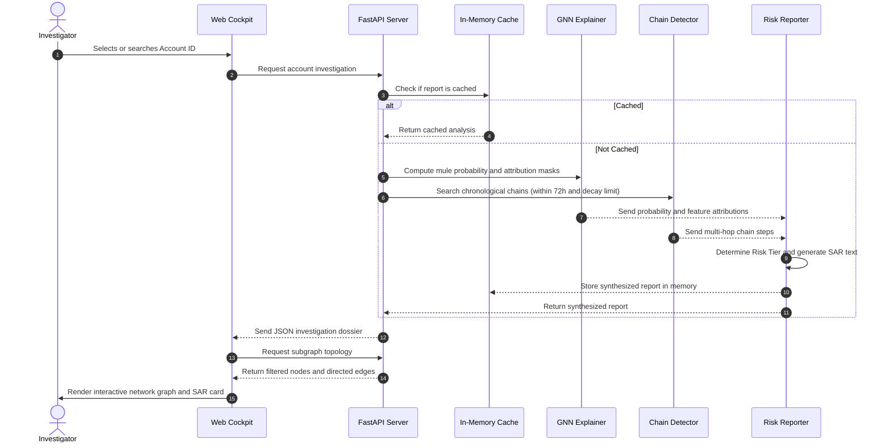

# Architecture & System Design — Chain Reaction (Mule-tiplier)

> **AML Money Mule Detection & Graph Intelligence Platform**  
> Complete technical reference covering data ingestion, graph representation, inductive Graph Neural Networks (GraphSAGE), temporal motif chain matching, explainability (GNNExplainer), compliance synthesis, and dual serving interfaces.

---

## 1. Executive Summary & Problem Formulation

### 1.1 The Anti-Money Laundering (AML) Dilemma
Traditional AML transaction monitoring systems rely predominantly on tabular rules (e.g., flat transaction threshold alerts above \$10,000) or row-level tabular machine learning models (e.g., Random Forests, XGBoost over raw transaction rows). In adversarial financial environments, sophisticated money laundering syndicates evade these checks by deploying **money mule networks**:
- **Layering & Structuring (Smurfing):** Transactions are systematically split into amounts well beneath statutory reporting limits.
- **Benign Individual Transactions:** Each deposit, transfer, or withdrawal appears innocuous in isolation.
- **Topological & Temporal Signatures:** The illicit signal is not in the row-level transaction amounts, but in the **graph topology** and **temporal velocity**:
  1. **Fan-In (Aggregation):** Rapid convergence of funds from multiple dispersed originator accounts into a single intermediary mule.
  2. **Short Holding Time (Velocity):** Funds dwell in the intermediary account for minutes or hours rather than normal retail dwell times (weeks or months).
  3. **Fan-Out (Dispersal) or Layering (Chains):** Immediate pass-through of funds to subsequent hops or cash-out sinks, with a small percentage fee ("haircut") retained by the mule.



### 1.2 System Mission
**Chain Reaction (Mule-tiplier)** transforms raw transaction streams into an interactive graph intelligence platform that:
1. Formulates banking transactions as a directed dynamic graph $G = (V, E)$.
2. Trains an inductive **GraphSAGE** neural network using mini-batch neighbor sampling to capture structural and relational patterns across 2-hop neighborhoods.
3. Executes a deterministic **Temporal Motif Search Engine** to track multi-hop layering chains ($A \to B \to C \to D$) bounded by time and amount-decay invariants.
4. Generates post-hoc model interpretability via **GNNExplainer** to highlight critical features and high-weight incident transactions.
5. Synthesizes a composite risk tier and automated FinCEN-compliant **Suspicious Activity Report (SAR)** narrative.
6. Delivers these insights via an enterprise-grade **FastAPI backend** and a high-performance **cyberpunk graphite/lime visual cockpit**.

---

## 2. High-Level System Architecture

The following diagram illustrates the complete end-to-end data processing, model training, analytical inference, and serving architecture.



---

## 3. Component Deep Dive

### 3.1 Data Ingestion & Currency Standardization (`src/data_loader.py`)

Financial transactions in global correspondent banking occur across multiple fiat currencies and cryptocurrencies. To allow meaningful graph structural aggregation and GNN learning, amounts must be comparable.

- **Input:** Raw CSV transaction logs (`HI-Small_Trans.csv`) containing `from_Account`, `to_Account`, `Timestamp`, `Amount Paid`, `Payment Currency`, `Amount Received`, `Receiving Currency`, and `Is Laundering`.
- **Normalization:** Currency conversion dictionary `EXCHANGE_RATES_TO_USD`:
  - USD: 1.0, EUR: 1.08, GBP: 1.27, JPY: 0.0067, CNY: 0.14, INR: 0.012, CHF: 1.12, CAD: 0.73, BTC: 60,000.0, etc.
- **Output:** Standardized dataframe with `amount_paid_usd`, `amount_received_usd`, and parsed `Timestamp` datetime objects.

### 3.2 Graph Construction & Topology Cache (`src/graph_builder.py`)

- **Topology Representation:** Models transactions as a directed multigraph collapsed to a directed graph $G = (V, E)$ where:
  - $V$: Unique bank accounts (nodes).
  - $E$: Directed transfers from source account to destination account (edges).
  - Edge Attributes: `amount` (standardized USD), `timestamp` (POSIX datetime), `is_laundering` (binary ground truth).
- **Serialization:** Graph construction across 5.08M rows takes significant memory and CPU time. The builder implements a deterministic caching mechanism saving serialized `nx.DiGraph` to `outputs/cache/graph.pkl`. If `rebuild=0` and the file exists, the pre-built graph is memory-mapped immediately.
- **Ego-Network Extraction:** Implements `plot_account_subgraphs` via `nx.ego_graph(G, account, radius=k)` for visual inspection of local neighborhoods.

### 3.3 Account Feature Engineering (`src/feature_engineering.py`)

A set of 8 handcrafted topological, financial, and temporal features are extracted per account node to establish the tabular baseline and provide input node features ($X \in \mathbb{R}^{N \times 8}$) for the GraphSAGE model:

| Feature Name | Type | Mathematical / Computational Formulation | Anti-Money Laundering Rationale |
| :--- | :--- | :--- | :--- |
| `in_degree` | Integer | $\text{deg}^-(u) = \vert \{ v \in V : (v, u) \in E \} \vert$ | Measures fan-in smurfing; high in-degree indicates multiple deposit sources. |
| `out_degree` | Integer | $\text{deg}^+(u) = \vert \{ v \in V : (u, v) \in E \} \vert$ | Measures fan-out layering or dispersal to cash-out points. |
| `total_in` | Float (USD) | $\sum_{(v, u) \in E} \text{amount}(v, u)$ | Cumulative incoming capital volume. |
| `total_out` | Float (USD) | $\sum_{(u, v) \in E} \text{amount}(u, v)$ | Cumulative outgoing capital volume. |
| `pagerank` | Float | Centrality vector $\mathbf{p} = \alpha \mathbf{W}^T \mathbf{D}^{-1} \mathbf{p} + \frac{1-\alpha}{N}\mathbf{1}$ | Identifies accounts structurally central to systemic transaction flows. |
| `avg_holding_time` | Float (sec) | Forward nearest-neighbor match via `pd.merge_asof`: $\Delta t = t_{\text{out}} - t_{\text{in}}$ | Core mule signature: rapid turnaround (< 24h) between deposit and forwarding. |
| `has_outflow_after_inflow` | Binary | $\mathbb{I}(\text{avg\_holding\_time} > 0)$ | Distinguishes pass-through accounts from pure originators or sinks. |
| `unique_counterparties` | Integer | $\vert \text{Predecessors}(u) \cup \text{Successors}(u) \vert$ | Quantifies breadth of account's transactional network. |

#### Vectorized Holding Time Algorithm
Rather than iterating over accounts or sorting rows sequentially in quadratic time ($O(N^2)$), `compute_avg_holding_time` implements a high-performance vectorized merge:
1. Extract and sort incoming events: `(to_Account, in_time)`.
2. Extract and sort outgoing events: `(from_Account, out_time)`.
3. Execute `pd.merge_asof(incoming, outgoing, left_on='in_time', right_on='out_time', by='account', direction='forward')`.
4. Group by account and compute mean difference in seconds.

### 3.4 Distributed Scaling Engine (`src/spark_features.py`)

For enterprise-scale AML deployments (e.g., IBM HI-Medium with 30M+ transactions or HI-Large with 100M+ transactions):
- Uses **Apache Spark (PySpark)** SQL and DataFrame API.
- Replaces pandas joins with distributed `groupBy().agg()` operations.
- Re-implements temporal holding time using **Spark Window Functions**:
  ```python
  window_spec = Window.partitionBy("account").orderBy("Timestamp")
  ```
- Evaluates inbound and outbound transaction sequences across executor partitions, enabling linear horizontal scaling without driver out-of-memory errors.

### 3.5 Partitioning & PyTorch Geometric Data Pipeline (`src/splits.py`, `src/gnn_data.py`)

1. **Stratified Splitting (`src/splits.py`):**
   - Money mule accounts represent only ~1.23% of the total dataset.
   - Partitions accounts into **70% Train**, **10% Validation**, and **20% Test** using stratified sampling on `is_laundering`.
   - Prevents data leakage: Splitting occurs strictly at the **account level**, ensuring no target account appears across multiple splits.
2. **PyG Data Conversion (`src/gnn_data.py`):**
   - **Node Features ($X$):**
     - Heavy-tailed distribution correction: `np.log1p()` applied to `in_degree`, `out_degree`, `total_in`, `total_out`, `unique_counterparties`, and `avg_holding_time`.
     - Scaled PageRank: PageRank values across 515K nodes average $\sim 2 \times 10^{-6}$; rescaled via $\ln(1 + \text{PageRank} \times N)$.
     - Leak-free standardization: `StandardScaler` is fitted **exclusively on the training accounts** (`train_mask`), then applied to validation and test accounts.
   - **Edge Connectivity (`edge_index`):**
     - Graph edges are converted to tensor format $[2, E]$.
     - **Bidirectional Augmentation:** Computes reverse edges `torch.cat([edge_index, edge_index.flip(0)], dim=1)` so that message passing in GraphSAGE can propagate information both upstream and downstream, while directional edge features retain true payment flow direction.

---

## 4. Machine Learning & Detection Engines

### 4.1 Inductive Graph Neural Network: GraphSAGE (`src/gnn_model.py`)

To overcome the limitations of tabular models (which cannot aggregate relational context beyond 1-hop summary statistics) and full-batch GNNs (such as standard GCNs which suffer from GPU out-of-memory bottlenecks on 5M+ edges), the platform implements an **inductive GraphSAGE** model.

```mermaid
flowchart LR
    subgraph Sampling ["2-Hop Neighbor Sampling"]
        H2["Hop-2 Neighbors (Sample: 10)"]
        H1["Hop-1 Neighbors (Sample: 15)"]
        SEED["Target Seed Accounts (Batch: 2048)"]
        H2 -->|"Aggregate 1"| H1
        H1 -->|"Aggregate 2"| SEED
    end

    subgraph NeuralNet ["GraphSAGE Architecture"]
        CONV1["SAGEConv Layer 1: 8 to 64 Dim"]
        ACT1["ReLU and Dropout 0.3"]
        CONV2["SAGEConv Layer 2: 64 to 64 Dim"]
        ACT2["ReLU and Dropout 0.3"]
        HEAD["Linear Classification Head: 64 to 1"]
        PROB["Sigmoid Output: Mule Probability"]

        CONV1 --> ACT1
        ACT1 --> CONV2
        CONV2 --> ACT2
        ACT2 --> HEAD
        HEAD --> PROB
    end

    SEED --> CONV1
```



#### Layer Formulation
For node $v$ at layer $k$:
$$h_{\mathcal{N}(v)}^{(k)} = \text{AGGREGATE}_k \left( \left\{ h_u^{(k-1)}, \forall u \in \mathcal{N}(v) \right\} \right)$$
$$h_v^{(k)} = \sigma \left( \mathbf{W}^{(k)} \cdot \left[ h_v^{(k-1)} \,\|\, h_{\mathcal{N}(v)}^{(k)} \right] \right)$$
Where:
- $\text{AGGREGATE}$ uses the mean operator (`SAGEConv`).
- Hidden dimension: 64.
- Total layers: 2 (avoids graph over-smoothing where node embeddings converge to identical vectors).
- Mini-batch neighbor sampling: `NeighborLoader(num_neighbors=[15, 10], batch_size=2048)`.
- Loss function: `BCEWithLogitsLoss`.

#### Validation-Tuned Operating Threshold
Due to the extreme class imbalance (1.23% positive rate), standard 0.5 thresholding yields poor alert utility. The threshold $t = 0.5254$ is calibrated on the validation set to maximize the $F_1$ score:
$$t^* = \arg\max_{t} F_1(\text{Val}, t) = \arg\max_t \frac{2 \cdot P(t) \cdot R(t)}{P(t) + R(t)}$$
This calibrated threshold is subsequently evaluated on the holdout test set without modification.

#### Benchmark Performance

| Model | Val PR-AUC | Test PR-AUC | Test Precision | Test Recall | Key Architectural Advantage |
| :--- | :--- | :--- | :--- | :--- | :--- |
| **Random Floor** | 0.0123 | 0.0123 | 0.0123 | 1.0000 | Theoretical lower bound based on class prevalence |
| **XGBoost Baseline** | 0.0855 | 0.0834 | 0.1178 | 0.1880 | Gradient boosted trees over 8 tabular node features |
| **GraphSAGE (Ours)** | **0.2091** | **0.1884** | **0.2827** | **0.1495** | **+128% PR-AUC lift; 2.4x precision purity** |

### 4.2 Algorithmic Multi-Hop Temporal Motif Search (`src/chain_detector.py`)

While GraphSAGE excels at localized 2-hop structural aggregation, deep laundering layering chains ($A \to B \to C \to D \to E$) are difficult for GNNs to resolve directly due to over-smoothing when layer depth increases ($L > 3$).

`TemporalChainDetector` complements the neural network by executing a pruned **Depth-First Search (DFS)** over transaction subgraphs enforcing financial and temporal invariants:


#### Chain Constraints
1. **Chronological Forward Flow:** $\text{Timestamp}(s_{i+1}) > \text{Timestamp}(s_i)$.
2. **Temporal Hop Window:** $\text{Timestamp}(s_{i+1}) - \text{Timestamp}(s_i) \le \Delta t_{\text{max}} = 72 \text{ hours}$.
3. **Total Chain Lifespan:** $\text{Timestamp}(s_{\text{end}}) - \text{Timestamp}(s_{\text{start}}) \le 240 \text{ hours}$ (10 days).
4. **Amount Decay / Mule Haircut:**
   $$\text{Amount}(s_{i+1}) \le \text{Amount}(s_i) \quad \text{and} \quad \text{Amount}(s_{i+1}) \ge (1 - \text{max\_decay}) \times \text{Amount}(s_i)$$
   Where $\text{max\_decay} = 0.20$ (permitting a 0% to 20% cut kept by the intermediary mule).
5. **Loop-Free Invariant:** $\forall i \neq j, \text{Account}_i \neq \text{Account}_j$ (acyclic path).

#### Account Role Classification
- **Initiator (Source):** Position 1 of an active chain ($A$).
- **Intermediary Mule (Pass-Through):** Middle position ($B, C$).
- **Cash-Out Sink:** Terminal node of an active chain ($D$).

### 4.3 Explainability & Feature Attribution (`src/explainer.py`)

Regulatory compliance mandates that automated fraud flags provide transparent, interpretable rationales.

- **PyG GNNExplainer:** Employs mutual information maximization between the original GraphSAGE prediction $Y$ and a compact subgraph computation graph $G_s$ with masked features $X_s$:
  $$\max_{G_s, X_s} \text{MI}(Y, G_s, X_s) = H(Y) - H(Y \mid G = G_s, X = X_s)$$
- **Node Feature Mask:** Learns continuous weights $M_f \in [0, 1]^8$ indicating which attributes (e.g., `avg_holding_time`, `out_degree`, `pagerank`) drove the classifier's decision.
- **Edge Attribution Mask:** Learns edge masks $M_e \in [0, 1]^{\vert E_{\text{local}} \vert}$ identifying which specific counterparty transactions contributed most strongly to the elevated risk probability.

### 4.4 Risk Reporting & SAR Synthesis (`src/risk_report.py`)

The platform integrates neural predictions and algorithmic chain motifs into a composite decision engine:



#### Automated FinCEN SAR Narrative Generator
`AccountRiskReporter._generate_sar_narrative` automatically synthesizes an audit-ready, legal-standard SAR narrative detailing:
- Primary suspect account identification and overall risk classification.
- Quantitative GraphSAGE mule probability and comparison against the optimal operating threshold.
- Attributed behavioral anomalies (e.g., compressed dwell time, skewed fan-in/fan-out ratio).
- Multi-hop traversal path, transaction timestamps, initial vs. retained funds, and intermediary haircut percentages.

---

## 5. Serving Infrastructure & User Interfaces

### 5.1 FastAPI Backend Architecture (`server.py`)

The production backend is implemented using **FastAPI** with ASGI architecture (`uvicorn`):

- **Memory Caching & Pre-Warming:**
  - `analysis_cache`: Thread-safe in-memory cache indexing investigated accounts.
  - Background daemon thread runs `prewarm()` on default preset accounts during server startup, allowing the HTTP port to bind immediately and answer queries with sub-millisecond latency.
- **REST Endpoints:**
  - `GET /api/v1/telemetry`: System operational telemetry, active device (`CUDA` / `CPU`), total monitored accounts (515,080), total transactions (5,078,345), model benchmark metrics, and curated preset accounts.
  - `GET /api/v1/accounts/search?q={query}`: Sub-50ms autocomplete search matching preset labels and raw account IDs.
  - `GET /api/v1/accounts/{id}/investigation`: Complete AML dossier combining GraphSAGE score, GNNExplainer feature rankings, chain profile, and complete SAR text.
  - `GET /api/v1/accounts/{id}/subgraph?chain_idx={idx}`: Returns nodes and directed edges formatted for interactive graph rendering.
    - *Threshold Gating:* Accounts with low risk ($P < 0.5254$ and not in chain) return only the isolated seed node, preventing DOM pollution.
    - *Chain Isolation:* For accounts in active layering chains, returns the exact directed chain path with hop numbering, timestamps, and amounts.
    - *Attribution Pruning:* For unchained suspicious accounts, returns only high-attribution incident links ($\text{importance} \ge 0.50$).
  - `GET /api/v1/benchmarks`: Model benchmark comparisons against baseline models.
  - Static Asset Mounting: Serves `frontend/` at `/static` and root `/`, and `outputs/` at `/outputs`.

### 5.2 Single Page Application Cockpit (`frontend/`)

Built strictly with vanilla JavaScript (ES6+), HTML5, and CSS3 according to the system visual guidelines (`docs/DESIGN.md`):

- **Palette & Tokens:** Deep graphite canvas (`#14161B`, `#1A1D24`, `#23262F`) with high-contrast **Lime Spark** (`#B6FF2E`) for active selections and primary actions, paired with semantic risk colors (Red `#EF4444`, Amber `#F59E0B`, Emerald `#10B981`).
- **Interactive Canvas / Force-Directed Graph:**
  - Nodes sized proportionally by topological role (Target: 24px, Sources/Sinks: 19px, Chain Mules: 16px).
  - Directed edges render flowing transaction arrows with dynamic thickness weighted by transfer amounts.
  - Zoom, pan, reset, and physics controls.
- **Feature Attribution Inspector:** Horizontal comparative progress bars showing percentage attribution from GNNExplainer alongside raw unnormalized values.
- **Chain Flow Timeline:** Step-by-step breadcrumb view displaying transfer timestamps, hop amounts, and the cumulative fee haircut.
- **SAR Export:** Instant one-click client-side download of the complete compliance dossier formatted in Markdown (`SAR_Investigation_Dossier_{account_id}.md`).

### 5.3 Interactive Streamlit Dashboard (`app.py`)

A secondary, Python-native analytical interface built with **Streamlit** for data scientists and ML engineers:
- Inspects dataset distribution statistics.
- Visualizes matplotlib precision-recall curves and training loss trajectories.
- Allows interactive testing of custom decision thresholds and ego-network radius adjustments.

---

## 6. Directory Structure & File Inventory

```
c:/Projects/Mule-tiplier/
├── README.md                           # Primary repository README & project overview
├── requirements.txt                    # Python runtime dependencies
├── server.py                           # Production FastAPI server & REST API
├── app.py                              # Streamlit interactive AML dashboard
├── skills-lock.json                    # Agent marketplace skill manifest
│
├── docs/                               # Project documentation & design specifications
│   ├── Architecture.md                 # Complete system & software architecture (this document)
│   ├── DESIGN.md                       # Comprehensive UI/UX visual design system & token specification
│   ├── MILESTONES.md                   # Chronological project milestones & technical roadmap
│   ├── PROJECT_STATUS.md               # Detailed completion status report across all milestones
│   └── Chain Reaction Visual Design Document.md # Untracked UI design drafting document
│
├── src/                                # Core algorithmic and machine learning source code
│   ├── __init__.py                     # Module package marker
│   ├── data_loader.py                  # Transaction ingestion & currency standardization
│   ├── graph_builder.py                # NetworkX directed graph builder & serialization
│   ├── feature_engineering.py          # Vectorized account-level graph feature extraction
│   ├── spark_features.py               # Distributed PySpark feature engineering for large datasets
│   ├── splits.py                       # Stratified train/val/test account partitioning
│   ├── gnn_data.py                     # PyTorch Geometric Data constructor & feature normalization
│   ├── gnn_model.py                    # GraphSAGE architecture, NeighborLoader & training loops
│   ├── chain_detector.py               # Algorithmic temporal motif chain search (DFS)
│   ├── explainer.py                    # GNNExplainer feature & edge attribution wrapper
│   ├── risk_report.py                  # Composite risk tiering & automated SAR narrative synthesis
│   ├── m3_experiments.py               # GraphSAGE vs baseline experimental runner
│   ├── run_m3.py                       # Milestone 3 training execution script
│   ├── generate_m3_comparison.py       # Benchmark table generation & metric computation
│   ├── generate_m3_plots.py            # Precision-recall curves & training loss visualization
│   └── test_m4_pipeline.py             # Integration test suite for Milestone 4 pipeline
│
├── frontend/                           # Production web application cockpit
│   ├── index.html                      # Semantic HTML5 single-page application structure
│   ├── app.js                          # State management, API integration & force graph rendering
│   └── style.css                       # Modern dark-first graphite/lime visual styles & tokens
│
├── notebooks/                          # Interactive research & development notebooks
│   ├── 01_data_exploration.ipynb       # EDA, currency inspection & baseline statistics
│   ├── 02_baseline_model.ipynb         # Feature extraction & XGBoost benchmark training
│   ├── 03_graphsage.ipynb              # PyG setup, GraphSAGE training & benchmark evaluation
│   ├── 04_chain_detection_and_explainability.ipynb # Motif search & GNNExplainer attribution
│   └── 05_scaling_and_demo.ipynb       # PySpark scaling experiments & demo verification
│
├── outputs/                            # Model weights, benchmark tables, and plot artifacts
│   ├── models/                         # Serialized models (graphsage.pt, model.json)
│   ├── cache/                          # Serialized graph structures (graph.pkl)
│   ├── figures/                        # Generated PR curves & GNN loss charts
│   └── results/                        # Evaluation metrics (m3_comparison.csv)
│
└── data/                               # Data storage (git-ignored)
    ├── raw/                            # Raw dataset files (HI-Small_Trans.csv)
    └── processed/                      # Preprocessed dataframes & feature matrices
```

---

## 7. Data Flow & Execution Sequences

### 7.1 Offline Training Sequence (Milestones 1–3)



### 7.2 Real-Time Investigation Query Sequence (Milestones 4–5)



---

## 8. Scalability, Security & Production Deployment Considerations

### 8.1 Scaling Dimensions
1. **Vertical Scaling (Single Node):**
   - Mini-batch neighbor sampling (`NeighborLoader`) enables GraphSAGE inference on graphs with millions of nodes without exceeding single-GPU VRAM (runs comfortably on an 8GB GPU or standard CPU).
2. **Horizontal Distributed Scaling:**
   - Feature engineering scales out through Apache Spark (`src/spark_features.py`) across an arbitrary number of cluster worker nodes.
   - For multi-billion edge graphs, PyG's `NeighborLoader` can be distributed across multi-node clusters using **PyG DistGNN** or **GraphSAINT**.
3. **Streaming Ingestion:**
   - Transaction feeds can be processed incrementally using Apache Kafka and Spark Structured Streaming, updating node feature vectors and appending edges to a graph database (e.g., Neo4j or Memgraph) for immediate query resolution.

### 8.2 Production Latency Optimization
- **Pre-Warming & In-Memory LRU Cache:** As demonstrated in `server.py`, pre-calculating high-volume accounts and caching queried results reduces response latency from $\sim 800\text{ms}$ (GNNExplainer optimization) to $< 2\text{ms}$.
- **Export to TorchScript / ONNX:** GraphSAGE weights can be exported to ONNX or TensorRT for sub-10ms batch forward passes during live transaction scoring.

### 8.3 Compliance & Governance
- **Human-in-the-Loop Triage:** Chain Reaction is architected as an **investigator accelerator and prioritization tool**, not an autonomous account freeze system. Final SAR filing decisions remain with human compliance officers.
- **Audit Trails:** Every risk score is accompanied by mathematical feature importance percentages and exact counterparty transaction identifiers, ensuring regulatory defensibility under Basel AML and FinCEN standards.
